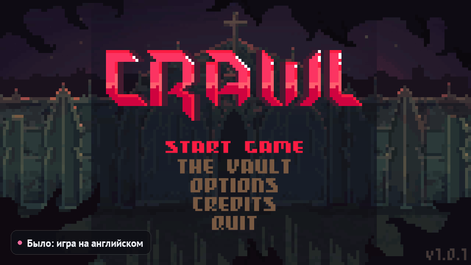

# Русификатор игр

**Автоматическая русификация PC-игр на Unity, Ren'Py и RPG Maker — и живой перевод поверх
любых других игр.** Выберите игру из списка, выберите способ перевода, нажмите кнопку — и
получите русскую версию. Движок определяется сам, оригинальные файлы сохраняются, откат —
одной кнопкой.

[](https://github.com/sgfsd/game-russificator/releases/latest)
[](https://github.com/sgfsd/game-russificator/releases)
[](LICENSE)

<p align="center">
  
</p>

<p align="center"><sub>
Crawl (Unity), настоящая запись: оригинал → одна кнопка → тот же экран по-русски. Русские буквы
нарисованы в пиксельном шрифте самой игры. Прогресс ускорен — на деле ≈ 7 минут, машинный перевод
офлайн. <a href="docs/media/demo.mp4">Видео в 1080p</a>
</sub></p>

Свободная программа с открытым кодом. Работает на вашем компьютере: без регистрации, без
серверов, без отправки файлов игры куда-либо. Ничего не просит и ничего не продаёт.

Главное, чем программа отличается от ручной настройки XUnity.AutoTranslator и подобных
инструментов:

- **Одна кнопка вместо инструкции на 15 шагов.** Плагины, конфиги, выбор шрифта, кодировки —
  всё делается само.
- **Кириллица дорисовывается в шрифты самой игры** по её же меркам, поэтому русский текст
  выходит того же размера, что английский, — а не «квадратиками» и не системным Arial в
  полтора раза крупнее.
- **Патч и живой перевод в одном.** Что не берётся правкой файлов (надписи на текстурах,
  Unreal, Godot), переводится поверх экрана.
- **Готовый русификатор для друга** — архив с установщиком, который сам находит игру в
  Steam, GOG или Epic.

## Содержание

[Скачать](#скачать) · [Как пользоваться](#как-пользоваться) · [Способы перевода](#способы-перевода) ·
[Движки и шрифты](#движки) · [Живой перевод](#живой-перевод-поверх-любой-игры) ·
[Русификатор для друзей](#русификатор-для-друзей) · [Мои игры](#мои-игры) ·
[Ограничения](#ограничения-и-известные-проблемы) · [Антивирус и SmartScreen](#почему-windows-и-антивирус-ругаются) ·
[Помощь](#помощь-ошибки-идеи) · [Разработка](#запуск-из-исходников) · [Лицензия](#лицензия)

## Скачать

### ⬇ [Скачать последнюю версию (Russificator-win64.zip)](https://github.com/sgfsd/game-russificator/releases/latest/download/Russificator-win64.zip)

1. Скачайте архив по ссылке выше (что нового — на странице [последней версии](../../releases/latest)).
2. Распакуйте в любую папку (лучше не в `Program Files`) и запустите `Russificator.exe`.
3. Если Windows покажет «Система Windows защитила ваш компьютер» — «Подробнее» → «Выполнить в
   любом случае». Почему так происходит и что с этим делать, честно разобрано
   [ниже](#почему-windows-и-антивирус-ругаются).

Нужна Windows 10/11 (64-бит). Python не нужен. Все модели и настройки хранятся рядом с
программой, в папке `RussificatorData`. Чтобы удалить программу, удалите её папку.

## Как пользоваться

1. **Игра**: выберите её во вкладке **«Мои игры»** или кнопкой «Обзор…» укажите корень игры
   (где лежит `.exe`). Программа покажет движок.
2. **Способ перевода**: одна из трёх плиток (ниже).
3. **«Русифицировать»**: программа найдёт текст, переведёт, встроит перевод и исправит шрифты.
   Перевод можно остановить — при следующем запуске он продолжится с того же места. Уже
   переведённое запоминается и повторно не переводится.

После русификации игру можно запускать как обычно. Кнопка **«Откатить»** возвращает игру в
исходное состояние. В игре **`Alt+T`** переключает перевод и оригинал (Unity, Ren'Py,
RPG Maker MV/MZ — реплики и выборы).

## Способы перевода

| | Способ | Для кого | Что нужно | Качество |
|---|---|---|---|---|
| 1 | **Машинный переводчик** (OPUS-MT, офлайн) | любой, даже очень старый ПК | ~245 МБ, 2 ГБ ОЗУ | черновое, дословное |
| 2 | **Нейросеть на компьютере** (Gemma 4 через llama.cpp) | ПК с 8+ ГБ ОЗУ или видеокартой | 2,6–7 ГБ на диске | хорошее |
| 3 | **Облачная нейросеть** по вашему API-ключу | любой ПК с интернетом | ключ провайдера | лучшее |

Если ПК и интернет позволяют, **берите нейросеть, а не машинный переводчик**: машинный
переводит слово за словом и без контекста — он здесь для старых и слабых машин, где больше
ничего не запустится.

**Машинный переводчик** скачивается один раз и работает без интернета. Самый быстрый и
нетребовательный способ.

**Нейросеть на компьютере** переводит с учётом контекста (кто говорит, соседние реплики).
Программа сама скачает модель и подберёт её под ваше железо:

| Модель | Размер | Подойдёт |
|---|---|---|
| Gemma 4 E2B — лёгкая | 2,6 ГБ | ноутбуки, ПК с 8 ГБ ОЗУ |
| Gemma 4 E4B — оптимальная | 4,2 ГБ | 16 ГБ ОЗУ или видеокарта 6+ ГБ |
| Gemma 4 12B — лучшая | 7,0 ГБ | видеокарта 10+ ГБ |

Работает на видеокартах NVIDIA, AMD и Intel (Vulkan), без видеокарты — на процессоре
(медленнее). Можно указать и свой `.gguf`-файл.

**Облачная нейросеть**: выберите провайдера, вставьте ключ, нажмите «Обновить список» —
программа покажет актуальные модели, подходящие для перевода, первыми. Рекомендации:

| Провайдер | Почему |
|---|---|
| Google Gemini | есть бесплатный дневной лимит — начать можно без денег |
| DeepSeek | дёшево и отлично знает русский |
| OpenRouter | сотни моделей по одному ключу, есть бесплатные (`:free`) |
| OpenAI, Anthropic, Mistral | высокое качество |
| Ollama, LM Studio | своя модель на своём ПК |
| Другой | любой OpenAI-совместимый API: адрес `…/v1`, ключ, модель |

Ключ хранится только на вашем компьютере в зашифрованном виде (Windows DPAPI) и отправляется
только выбранному провайдеру.

## Движки

| Движок | Что переводится | Как встраивается |
|---|---|---|
| **Unity** (Mono и IL2CPP) | весь текст интерфейса и диалогов, в том числе собранный игрой на лету; диалоги в текстовых ассетах (JSON, CSV, XML, Ink, Yarn); страницы встроенного браузера (ZFBrowser) | BepInEx + XUnity.AutoTranslator, словарь перевода и плагин русификатора; файлы игры не правятся (кроме шрифтов и страниц браузера) |
| **Ren'Py** | реплики, рассказчик, меню выбора, `_()`-строки, имена, надписи экранов, `renpy.notify`/`input`/`Confirm`…; скрипты `.rpy`, `.rpyc`, архивы `.rpa` | отдельный файл перевода + фильтр текста в игре; исходники не меняются |
| **RPG Maker MV / MZ** | сообщения, выборы, прокрутка текста, база данных, термины, названия карт, надписи плагинов (`plugins.js`, команды плагинов MZ), `$gameMessage.add` в скриптах | прямо в `data/*.json` и `js/plugins.js` + плагин переноса слов |
| **RPG Maker XP / VX / VX Ace** | то же (Ruby Marshal), в том числе из архивов `.rgssad`/`.rgss2a`/`.rgss3a`, плюс надписи в скриптах игры (модуль `Vocab`, команды меню) | в `Data/*.rxdata`/`.rvdata`/`.rvdata2` и `Data/Scripts.*` |

**Шрифты.** Почти все западные игры рисуют текст шрифтами без кириллицы — русские буквы
превращаются в «квадратики» или берутся из системного Arial другого роста (текст в
полтора-два раза крупнее и наезжает строками). Программа сама дописывает русские буквы в
каждый шрифт игры — TTF/OTF, атласы TextMeshPro, растровые шрифты Unity, шрифты Ren'Py и
RPG Maker — по меркам самого шрифта: та же высота заглавных и строчных, та же ширина,
толщина штриха и наклон; у пиксельных шрифтов буквы собираются из пикселей той же сетки, а
буквы, совпадающие с латинскими (А, В, Е, К, М, Н, О, Р, С, Т, Х…), берутся из самого
шрифта. Поэтому русский текст выходит того же размера, что английский.

**Полнота перевода (Unity).** Всё, что игра показала, а при русификации найдено не было,
переводится на лету, входит в архив для друзей и в словарь следующей русификации. В «Моих
играх» кнопка «Полнота перевода» показывает такие строки и где каждая лежит в файлах игры.

**Русский текст длиннее английского** — и за этим программа следит на каждом движке:

- **Unity:** плагин русификатора прямо в игре проверяет каждый переведённый элемент и, если
  текст вылезает за рамку или рвёт слово, уменьшает шрифт (не мельче 60%); надпись, которая
  по-английски помещалась в одну строку, остаётся в одну строку.
- **RPG Maker:** строки сообщений переносятся по ширине окна в пикселях (по метрикам шрифта,
  с учётом лица персонажа, иконок и имён). В MV/MZ плагин русификатора ещё и в игре переносит
  слово, которое не влезло, а описания предметов и строки боя уменьшает; в VX Ace длинные
  описания разбиваются на две строки заранее.
- **Ren'Py:** если реплика не помещается в окно диалога, её шрифт уменьшается ровно настолько,
  чтобы влезла.

Пока текст помещается, ничего не меняется. Предел — 60% от исходного размера: если
по-английски надпись занимала всю рамку под завязку, русский перевод может всё равно
обрезаться (см. [известные проблемы](#ограничения-и-известные-проблемы)).

**Непереведённого не остаётся.** Строки, которые переводчик не осилил с первого раза (сбой
сети, сломанная разметка), переводятся ещё раз по одной, затем по кускам между тегами и, если
скачан машинный переводчик, им как запасным.

### Особенности Unity

- **Заранее переводится всё, что можно найти:** текст сцен и ассетов, строки кода, а ещё
  шаблоны, которые игра собирает сама («You have {0} coins», «Day » + n + « of » + m) — они
  становятся правилами XUnity и переводятся без интернета и без программы.
- **Живая доводка** — редкий текст, которого не было нигде (собранный кодом на лету),
  переводится прямо во время игры и запоминается (сколько таких строк — видно в «Моих играх»).
  Она включается сама, как бы игру ни запустили — из Steam, ярлыком или exe: плагин
  русификатора (Mono — BepInEx 5, IL2CPP — BepInEx 6) при старте игры запускает программу в
  фоне и закрывает её вместе с игрой. Не перемещайте и не удаляйте папку русификатора
  (перенесли — русифицируйте игру ещё раз, готовый перевод возьмётся из памяти).
- При первой русификации Unity-игры скачиваются BepInEx и XUnity.AutoTranslator (1,5 МБ, для
  IL2CPP-игр — больше; один раз на все игры).
- IL2CPP-игры запускаются с BepInEx первый раз 1–5 минут — это нормально.
- В игре `Alt+T` переключает оригинал/перевод.

## Живой перевод поверх любой игры

Включите **«Живой перевод»** один раз — программа будет ждать в трее и, как только на экране
игра, распознавать **всё, что на нём написано**, и показывать перевод поверх оригинала:
интерфейс и диалоги, надписи на картинках и текстурах, кнопки-картинки, пиксельные и
стилизованные шрифты. Подходит для любых игр (Unreal, Godot, Game Pass, онлайн-игры), а в
играх, русифицированных файлами, дополняет перевод: русский текст не трогает, переводит то,
что осталось на английском (заставки, таблички, надписи на текстурах).

- Перевод встаёт **на место** английского текста — в том же цвете и похожем шрифте, того же
  размера (у похожих надписей игры — один размер, без «прыжков»); длинный русский текст
  занимает свободный фон рядом, а не мельчит.
- Работает по событиям: неподвижный экран распознаётся один раз, распознаётся только та часть
  кадра, где сменился текст, перевод — по предложениям. Поэтому перевод на экране не «мигает»
  и не меняется сам по себе: он появляется один раз, когда текст допечатан, и исчезает сразу
  после того, как реплика пропала. Повторяющийся текст (меню, подсказки) — сразу из памяти
  переводов.
- Анимированный текст (дрожь, глитч, переливы), мигающий значок «дальше», анимированный фон и
  логотипы не сбивают перевод и не превращаются в мусор на экране.
- Работает в оконном режиме, «окне без рамки» и полноэкранном режиме Windows 10/11: если игра
  не отдаёт картинку со своего окна, кадр берётся с экрана, а окно перевода исключается из
  захвата.
- Надписи на картинках, мелкий и стилизованный текст: распознавание — нейросеть PP-OCRv5 (на
  видеокарте или процессоре — что быстрее на этом ПК); когда экран замирает, кадр
  распознаётся ещё и в полном разрешении. Ошибки распознавания исправляются по словарю
  («sraphic» → «graphic»).
- Не переводятся: русский текст (в том числе русификация самой игры), заголовок окна,
  названия движков и площадок («Made with Unity», «Discord», «Patreon»), логотип игры, имя
  героя табличкой над репликой.
- Игра определяется сама: «Мои игры», игры, которые знает игровая панель Windows, игры в окне
  с файлами движка рядом с exe (Unity, Ren'Py, RPG Maker, Unreal, Godot…) и любые окна на весь
  экран. Браузеры, мессенджеры, плееры и банковские программы не распознаются никогда.
  Ошиблась — списки «Всегда»/«Никогда»; игра не распозналась — «Переводить окно…» в меню
  значка в трее или на вкладке.
- `Alt+T` — показать/скрыть перевод, `Alt+Y` — перевести сейчас, `Alt+R` — обвести мышью
  область текста (например, только окно диалогов; запоминается для игры). Клавиши работают
  только пока на экране игра.
- Скорость: новая фраза с машинным переводчиком — доли секунды (на старом ПК — около секунды),
  с нейросетью на ПК — столько, сколько нейросеть переводит фразу (на слабой видеокарте —
  секунды). Замеры этого ПК видны на вкладке «Живой перевод».

## Русификатор для друзей

После русификации нажмите **«Создать файл русификатора»** — в выбранной папке появится
`<Игра> — русификатор.zip`. Отправьте его другу: он распакует архив, запустит
`Установить.exe` — установщик сам найдёт игру (Steam, GOG, Epic…) и поставит перевод.
Программа другу не нужна; удалить русификатор можно тем же установщиком.

- Файлов игры в архиве нет: только добавленное русификатором, бинарные патчи изменённых
  файлов и сам перевод — архив маленький.
- Другая версия игры у друга не ломается: RPG Maker переводит всё совпавшее (новые строки
  остаются английскими), Unity и Ren'Py ставят словарь как есть.
- По желанию в главном меню игры появится небольшая надпись «Автоперевод: Русификатор игр ·
  github.com/sgfsd/game-russificator» (во время игры её нет; галочку можно снять).
- Готовый архив можно поставить и из программы: «Мои игры» → «Установить русификатор из архива».

Выкладывать такие русификаторы куда угодно — ваше право: перевод ваш, программа на него не
претендует. Пожалуйста, уважайте позицию разработчиков игры насчёт фанатских и машинных
переводов и убирайте файлы по первой их просьбе.

## Мои игры

Вкладка сама находит установленные игры: Steam (все библиотеки), GOG, Epic, Ubisoft Connect,
itch.io, Game Pass, игры из списка программ Windows и из ваших папок (Настройки → «Папки для
поиска игр»). У каждой — обложка, движок и состояние: *на русском*, *перевод слетел после
обновления* (кнопка «Переустановить перевод» — готовые строки возьмутся из памяти), *можно
русифицировать* или *только живой перевод* — состояние каждый раз проверяется по файлам игры,
так что после обновления или переустановки игры оно не врёт. Отсюда же — «Играть», «Откатить»,
ярлык и архив для друзей, «Сменить обложку» (любая картинка). Лишнее можно скрыть — скрытые
игры лежат во вкладке «Скрытые» и возвращаются одной кнопкой. Игры нет в списке — «Добавить
папку игры».

## Ограничения и известные проблемы

Честно о том, где программа не справляется.

**Чего она не делает:**

- Текст, нарисованный на картинках (вывески, таблички, логотипы), файловая русификация не
  переводит — его переводит живой перевод поверх игры.
- Игры с шифрованием или защитой от модификаций могут не поддаваться файловой русификации —
  для них есть живой перевод поверх экрана.
- RPG Maker 2000/2003, Unreal, Godot, GameMaker пока не поддерживаются файлами (только живой
  перевод).
- Живой перевод не видит игру в «настоящем» эксклюзивном полноэкранном режиме, который Windows
  не умеет оптимизировать (например, OpenGL на видеокартах AMD): поверх такой игры не может
  рисовать ни одна программа без внедрения в неё — программа подскажет включить «окно без
  рамки».

**Известные проблемы:**

- **Текст иногда всё-таки обрезается.** Программа уменьшает шрифт, но не мельче 60% от
  исходного: если английская надпись занимала рамку под завязку, русская может не влезть.
  Чаще всего это видно в узких пузырях реплик и в описаниях предметов.
- **Сильно стилизованные надписи** (штампы, логотипы, рукописные шрифты) распознавание может
  не прочитать — тогда они остаются как есть.
- **Машинный перевод — черновой.** «Spawning monsters» он может превратить в «населяя
  монстров». Для играбельного результата выбирайте нейросеть.
- **Онлайн-игры и античит.** Файловая русификация Unity-игры добавляет в неё BepInEx — это
  модификация, и в игре с античитом она может привести к блокировке аккаунта. Для таких игр
  пользуйтесь только живым переводом поверх экрана (он ничего не внедряет в игру), но и это
  не даёт никаких гарантий.

Нашли что-то ещё — [напишите](#помощь-ошибки-идеи), это и есть самый полезный вклад.

## Почему Windows и антивирус ругаются

Программа не подписана сертификатом (сертификат для подписи кода стоит денег, а проект
бесплатный), поэтому Windows SmartScreen показывает «Система Windows защитила ваш
компьютер», а некоторые антивирусы — предупреждение. Так бывает со всеми неподписанными
программами, собранными PyInstaller, и тем более с теми, что умеют то, что умеет эта:
дописывать файлы в папку игры и подгружать в игру плагин. Для антивируса это выглядит
подозрительно по форме, независимо от содержания.

Чем это можно проверить, не доверяя на слово:

- **Код открыт целиком** — всё, что делает программа, лежит в этом репозитории.
- **Сборка идёт на серверах GitHub**, а не на компьютере автора: как собирается архив из
  релиза, видно в [.github/workflows/build.yml](.github/workflows/build.yml) и в логах
  [Actions](../../actions). Это можно повторить у себя и сравнить результат.
- **Файл из релиза можно проверить** на [VirusTotal](https://www.virustotal.com/gui/home/upload)
  перед запуском.
- Можно [запустить из исходников](#запуск-из-исходников) и вообще не связываться с exe.

Программа не требует прав администратора, никуда не отправляет файлы игры и работает без
интернета — кроме скачивания моделей и плагинов с официальных источников и запросов к
облачному переводчику, если вы сами его выбрали.

## Помощь, ошибки, идеи

Проект делает один человек, и каждое сообщение действительно читается. Пишите по любому
поводу — не только о поломках:

- **[Ошибки и обсуждения на GitHub](../../issues)** — лучший способ: видно другим, не теряется.
  Для поломок есть шаблон «Игра не переводится».
- **Telegram [@TRAPYCHINO](https://t.me/TRAPYCHINO)** — если так привычнее или вопрос короткий.

Если что-то сломалось, нажмите **«Скопировать отчёт об ошибке»** — в окне «Помощь» или над
журналом на экране русификации — и вставьте текст в сообщение. В отчёте уже есть всё, что нужно
для разбора: версия программы, Windows, видеокарта и память, способ перевода, игра и её движок,
конец журнала. Ключей API и путей с именем пользователя в нём нет. Останется дописать, что
делали и что было на экране (скриншот очень помогает).

Про что писать не стесняйтесь: игра не определяется, перевод не встраивается, «квадратики»
вместо букв, живой перевод не видит игру, хочется поддержки нового движка или просто «а можно
ли…». Если в вашей игре что-то не работает — скорее всего, не работает у целого класса игр, и
это стоит починить.

**Вклад в код** приветствуется: pull request'ы, разборы движков, глоссарии имён и терминов для
конкретных игр. Устройство программы описано в [docs/HOW-IT-WORKS.md](docs/HOW-IT-WORKS.md).

## Поддержать проект

Программу делаю один — в свободное время, бесплатно и без рекламы, и так будет дальше. Если она
сэкономила вам нервы или часы возни с переводом и хочется сказать спасибо, можно поддержать
рублём — это никого ни к чему не обязывает, а программа от этого не изменится:

**Карта: `2200 2488 7085 6894`**

Деньги уходят на то, чтобы проверять русификатор на новых играх и чинить то, что в них ломается.
Не хочется или нечем — тоже отлично: звезда на GitHub, сообщение об ошибке или рассказ друзьям
помогают не меньше.

## Запуск из исходников

Нужен Python 3.10+ (проверено на 3.14).

Окно программы — двойной клик по **`start.bat`**: при первом запуске он сам создаёт окружение
`.venv` и ставит в него компоненты (нужен интернет, несколько минут), дальше сразу открывает
программу. `Русификатор.pyw` тоже работает — если его открыл «не тот» Python, он
перезапустится через `.venv`.

Вручную:

```bash
python -m venv .venv
.venv\Scripts\python -m pip install -c requirements-lock.txt -e .
.venv\Scripts\pythonw Русификатор.pyw
```

Командная строка (из `.venv`):

```bash
russificator detect "C:/Games/MyGame"
russificator run "C:/Games/MyGame"                                   # машинный перевод
russificator run "C:/Games/MyGame" --mode local --local-model gemma4-e4b
russificator run "C:/Games/MyGame" --mode cloud --provider deepseek --api-key КЛЮЧ
russificator models --provider gemini --api-key КЛЮЧ                  # модели провайдера
russificator play "C:/Games/MyGame"                                  # Unity: игра + живой перевод
russificator restore "C:/Games/MyGame"
russificator export "C:/Games/MyGame" --out "D:/Русификаторы"        # архив для друзей
russificator install "D:/MyGame — русификатор.zip" "C:/Games/MyGame"
russificator games                                                   # установленные игры
```

Тесты: `pytest`. Устройство программы — в [docs/HOW-IT-WORKS.md](docs/HOW-IT-WORKS.md).

### Сборка exe

Сборка идёт на серверах GitHub ([.github/workflows/build.yml](.github/workflows/build.yml)):
отправьте тег (`git tag v2.4.0 && git push --tags`) — прогонятся тесты, соберутся установщик
для архивов (`installer.spec` → `RussificatorSetup.exe`) и `Russificator.exe`, пройдут
самопроверку, и программа появится в Releases архивом `Russificator-win64.zip`. Локально:
`pyinstaller installer.spec`, затем `pyinstaller russificator.spec` → `dist/Russificator/`.

Та же сборка запускается вручную (Actions → build → Run workflow) с любой ветки — архив
остаётся в артефактах. Заодно проверяется вживую:

- живой перевод на настоящей Windows (`tools/ci_overlay_check.py`): распознавание текста
  обоими способами, окна оверлея, сквозной путь «полноэкранная игра → перевод → плашка»;
- установщик ставит и удаляет русификатор в тестовую игру (`--selftest`);
- Ren'Py 8 и 7 (`tools/ci_renpy_check.py`): демо-игра из SDK русифицируется, ставится архивом
  «для друзей», проходит lint и запускается — надпись, реплики, Alt+T.

Плагины Unity (`resources/unity/*.dll`) собираются из `RussificatorUnity.cs` скриптом
`python tools/build_unity_plugins.py` (нужен `mcs` из Mono или `csc` из .NET Framework).

## Лицензия

Код программы — [GNU General Public License v3](LICENSE) или любая более поздняя версия.
Коротко: пользоваться, изучать, изменять и распространять можно бесплатно и без ограничений
по целям, в том числе в организации и за деньги; если вы распространяете программу или своё
изменённое её издание, вы отдаёте получателям исходный код под той же лицензией.

Версии до 2.2.1 включительно выпускались под MIT, версии 2.3.0–2.4.0 — под PolyForm
Noncommercial. Начиная с 2.4.1 проект под GPL v3: это настоящая открытая
лицензия, и ограничение «только некоммерческое использование» снято.

Нужно встроить код в закрытый продукт, без открытия исходников? Это решаемо отдельной
лицензией — см. [COMMERCIAL.md](COMMERCIAL.md).

Переводы, сделанные программой, принадлежат вам: лицензия на код не распространяется на
результат его работы.

### Сторонние компоненты

Скачиваются программой с официальных источников и распространяются на своих условиях:
[BepInEx](https://github.com/BepInEx/BepInEx) (LGPL-2.1),
[XUnity.AutoTranslator](https://github.com/bbepis/XUnity.AutoTranslator) (MIT),
[llama.cpp](https://github.com/ggml-org/llama.cpp) (MIT),
модели [OPUS-MT](https://github.com/Helsinki-NLP/Opus-MT) (Helsinki-NLP, CC-BY 4.0),
[PaddleOCR](https://github.com/PaddlePaddle/PaddleOCR) (Apache-2.0),
[Argos Translate](https://github.com/argosopentech/argos-translate) и
[Gemma](https://ai.google.dev/gemma) — на условиях их авторов. Отдельное спасибо авторам
BepInEx и XUnity.AutoTranslator: без них русификации Unity-игр здесь бы не было.

В программу встроены шрифт [PT Sans](https://www.paratype.ru/fonts/pt/pt-sans) (OFL 1.1) и
словарь английских слов из [SCOWL](http://wordlist.aspell.net/) en_US (© Kevin Atkinson,
свободная лицензия — `russificator/resources/licenses/SCOWL-en_US-wordlist.txt`).

### Про фанатские переводы

Перевод игры — это переработка произведения, и формально права на неё принадлежат
правообладателю (в России — пп. 9 п. 2 ст. 1270 ГК РФ). Сама программа — инструмент и ничьих
прав не нарушает; ответственность за то, что вы переводите и где это выкладываете, лежит на
вас. Архив «для друзей» не содержит файлов игры — только ваш перевод и патчи к изменённым
файлам.
